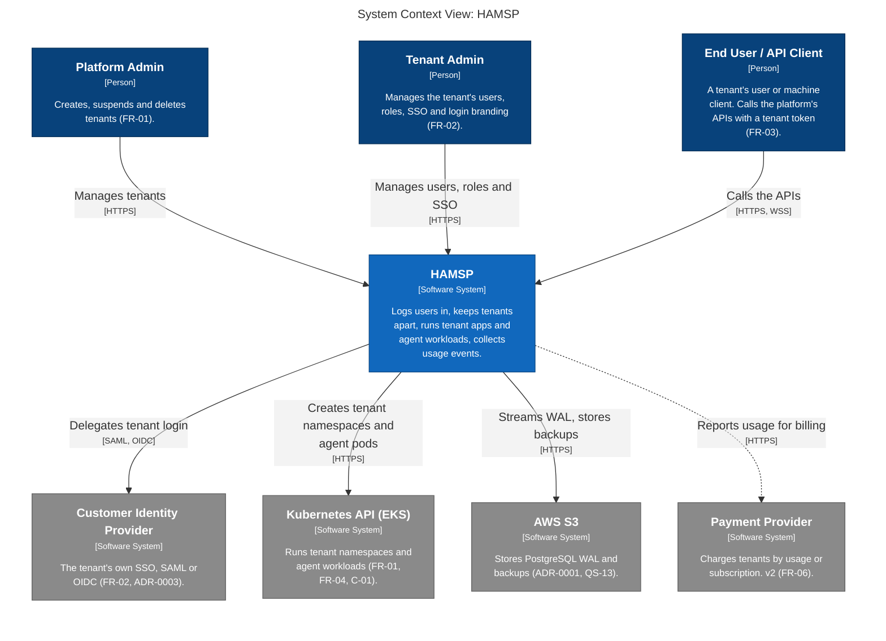
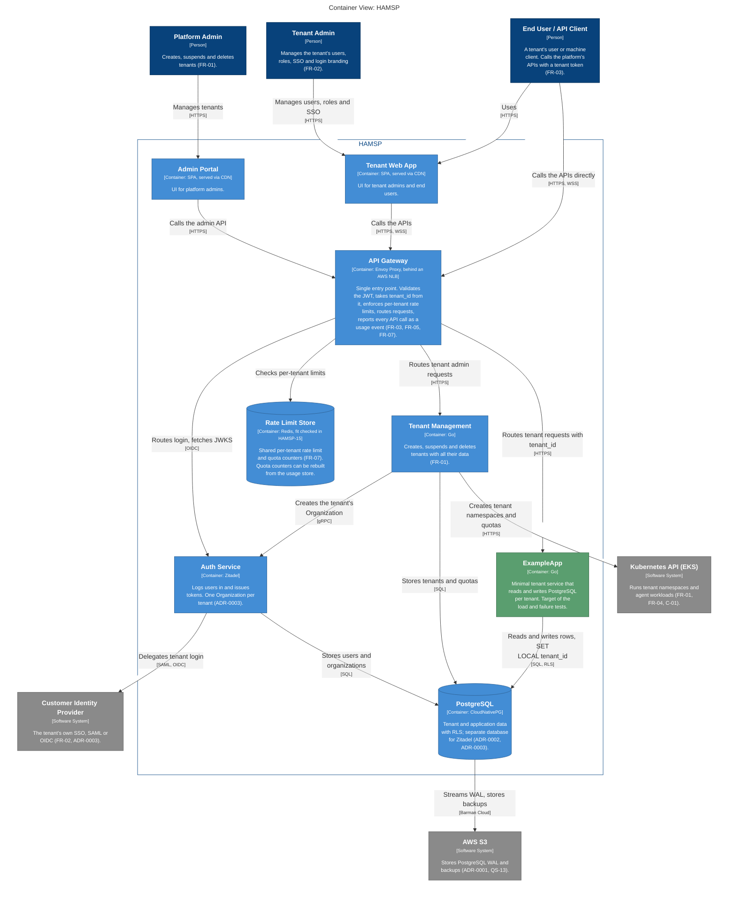
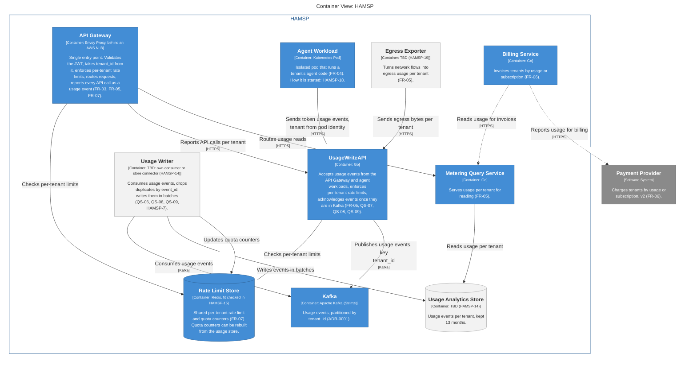

# C4 Model

[`workspace.dsl`](workspace.dsl) is the source of truth. The diagrams below are generated from it by [`render.sh`](render.sh); do not edit them by hand.

| View | Answers |
|---|---|
| System Context (L1) | Who uses HAMSP and which external systems it depends on. |
| RequestPath (L2) | How a request reaches tenant data, and how tenants are kept apart. |
| UsagePipeline (L2) | How a usage event becomes a stored record and is read back. |

Infrastructure (namespaces, node pools, Karpenter, KEDA, Cilium) belongs to a Deployment view, which is not drawn yet.

**Legend:** dark blue = person, blue = HAMSP, grey = external system, green = test service, dashed grey = placeholder (technology not chosen, see the issue in brackets), dashed and faded = planned for v2.

## Diagrams

<!-- diagrams:start -->

### System Context (L1)



### RequestPath (L2)



### UsagePipeline (L2)



<!-- diagrams:end -->

## Tooling

Structurizr needs Java 21+ ([binaries](https://docs.structurizr.com/binaries)), or Docker.

```bash
curl -fL -o ~/.local/lib/structurizr.war https://download.structurizr.com/structurizr.war
```

* Validate and regenerate the diagrams above: `./render.sh`. If Java 21+ is not registered with `/usr/libexec/java_home`, pass it: `JAVA=/path/to/java ./render.sh`.
* Browse and lay out views at http://localhost:8080: `java -jar ~/.local/lib/structurizr.war local docs/architecture/c4`.
* Docker instead of Java: `docker run -it --rm -p 8080:8080 -v "$PWD/docs/architecture/c4:/usr/local/structurizr" structurizr/structurizr local`.
