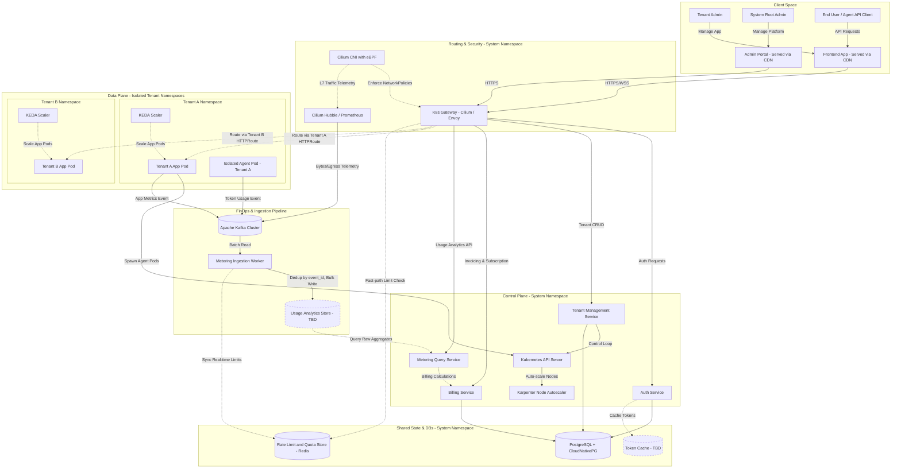

# High-Availability Multi-Tenant SaaS Platform (HAMSP)

HAMSP is an infrastructure boilerplate for B2B SaaS products in which many customer companies (tenants)
share one Kubernetes cluster and one database.
It logs users in, keeps tenants apart and takes in usage events from tenant apps and agent workloads. Usage-based billing is planned for v2.

---

## Master Navigation Hub

Every phase MUST also read [Requirements & Constraints](architecture/requirements.md) (FR, QS, C). The `verify` phase checks the work against its quality scenarios (QS-xx).

Specific technical constraints must be sourced from the specialized files below:
- [Data Tier (Zero Data Loss, RPO=0, RLS)](architecture/data-tier.md)
- [Ingestion & Telemetry Pipeline (Async Load Leveling)](architecture/ingestion-pipeline.md)
- [Networking & Security (Hard Multi-Tenant Isolation, Cilium)](architecture/networking-security.md)
- [Control Plane (Automated Recovery, RTO < 5s)](architecture/control-plane.md)
- [Operations & Infrastructure (Terraform)](ops/terraform.md)
- [Contracts](contracts/)
- [C4 model (Structurizr DSL)](architecture/c4/workspace.dsl): System Context and two Container views (RequestPath, UsagePipeline)

**Override Rule**: Accepted ADRs in [adr/](adr/) hold absolute priority over all other architectural documentation.

The ADR folder is the decision log. When an ADR changes something important in a subsystem, the subsystem file links to that ADR.

---

<h2 id="data-flow-diagram">Container and Data Flow Diagram</h2>

> **Note:** the diagram does not match ADR-0001 yet (tenant namespaces vs one shared API, Gateway vs ALB/NLB). See HAMSP-11.

---

<h2 id="directory-structure">Repository Structure</h2>
* `/terraform` - Infrastructure as Code for AWS EKS, Karpenter, and core cloud dependencies.
* `/k8s` - Kubernetes manifests, Helm charts, GitOps configuration (ArgoCD), and Cilium policies.
* `/docs/adr` - Architecture Decision Records (ADR) detailing design trade-offs.
* `/apps` - Core Go/Node.js high-throughput API implementation.
